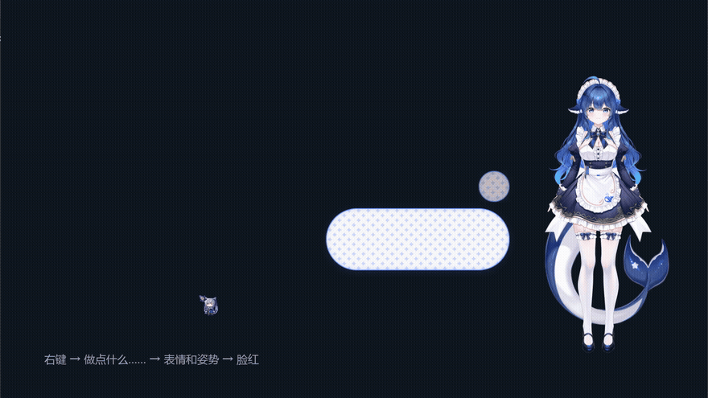
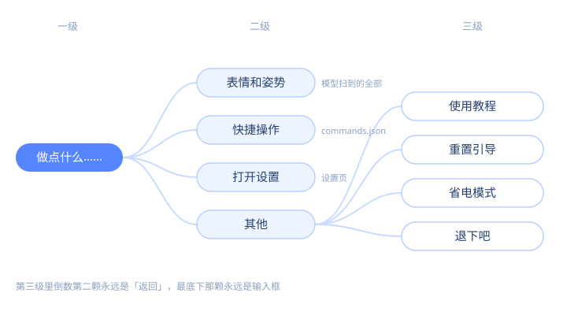
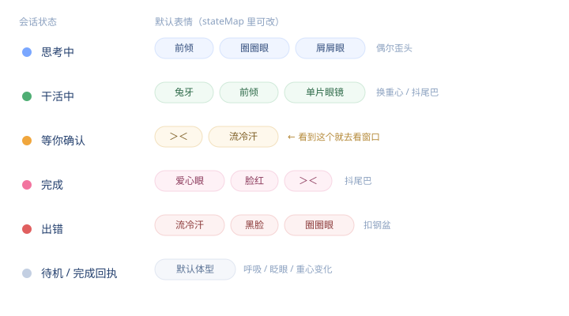

# BigFatBlueFish · 开源的 Windows Live2D 桌宠

<p align="center"></p>

一只住在桌面角落的 Live2D 角色：**透明无边框窗口**、始终置顶、不占任务栏、不用管理员权限。
她的表情和姿势由自己的状态机驱动（呼吸、眨眼、待机小动作），右键就能使唤；
接上 AI 助手后还能跟着会话状态变脸 —— 思考、干活、等你确认、完成、出错，看一眼就知道跑到哪了。

**想让 AI 助手帮你装？** 把这句丢给它：`照着 main/docs/install-agent.md 把 BigFatBlueFish 装好`
（人自己装也就三步，见下）。

- **透明无边框 + 参数直驱**：不是贴一张动图，而是 PixiJS 直接推 Cubism 模型参数，姿势/表情/物理都在跑
- **右键三级胶囊菜单**：表情、姿势、快捷指令、设置，全部两三下点到
- **可以接 AI 会话，也可以不接**：接 DSH 插件后表情跟随会话；不装插件就是一只完整的独立桌宠

> **本仓库不含 Live2D 模型**（模型版权归原作者，不转授权）。跑起来前先去 `main/model/README.md` 拿模型。



## 30 秒上手

1. **拿到代码**：`git clone https://github.com/TingNiKuaiYuKQ/BigFatBlueFish.git`，或下载 zip 解压（目录名随意，路径别带空格最省事）。
2. **放模型**：按 `main/model/README.md` 向模型原作者获取，解压进 `main/model/runtime/`
   （这一层直接能看到 `*.model3.json`）。
3. **双击 `start.cmd`**：第一次会装依赖、构建渲染包、启动；之后再双击根目录的 `launcher.lnk` 即可无黑框启动。

需要 **Windows 10/11 + Node.js 22 以上**。首次运行若提示「找不到 node.exe」，装个 Node 再来。

启动后：**左键点她**会回应，**右键短按**弹菜单，**右键按住 0.5 秒**进入拖拽/缩放。

## 功能一览

| 功能 | 怎么用 | 亮点 |
| --- | --- | --- |
| 右键胶囊菜单 | 右键短按 | 三级封顶，倒数第二颗永远是「返回」，最底下永远是输入框 |
| 表情与姿势 | 菜单 → 表情和姿势 | 表情从模型 `Exp3` 现场扫描，换模型自动跟着变 |
| 快捷指令 | 菜单 → 快捷操作 / 设置 → 指令 | exe / cmd / powershell / bat / 快捷方式五种；参数按行传，不拼 shell 字符串；捕获输出自动转 GBK |
| 绑定 AI 会话 | 设置 → 行为 → 绑定对话 | 会话状态实时映射成表情（见下图） |
| 省电模式 | 托盘左键 / 菜单 → 其他 | 半透明、降到 24 帧、不冒泡；全屏游戏自动进入 |
| 个性化 | 设置 → 外观 | 三个主题色、界面尺寸、帧率上限；换人设包只改一个配置项 |



## 与 AI 会话联动

装了 `pet-bridge`（`plugins/dsh/`）之后，桌宠会读会话状态文件，把
「思考中 / 干活中 / 等你确认 / 完成 / 出错」映射成表情和姿势；反过来，AI 也能让她
说话、换表情、播一套预设动作，甚至执行白名单里的快捷指令（新增/修改指令必须你点确认）。

插件是**可选**的：`main/config/config.json` 里 `driver.enabled=false` 就是纯独立桌宠，
不读任何外部状态、不写任何握手文件，菜单和表情照常。

## 自定义

- **换人设**（名字、称呼、口癖、提示词）：复制 `main/persona/blue-whale-maid/` 改，再把
  `config.json` 的 `persona` 指过去。手把手步骤在 `main/persona/README.md`。
- **换模型**：模型放进 `main/model/runtime/`，改 `config.json` 的 `model.file`。
- **换配色**：设置 → 外观，三个主题色改完立刻生效。
- **写自己的快捷指令**：五种类型的完整 JSON 模板在 `main/docs/commands-examples.md`。

## 目录结构

```text
BigFatBlueFish/
├─ main/                 运行所需的一切
│  ├─ modules/           core（入口/HTTP/路径）· ui · menu · settings · behavior · commands · low-power · tutorial
│  ├─ config/            config.json（设计参数）· commands.json（快捷指令）
│  ├─ persona/           人设包（默认 blue-whale-maid）
│  ├─ model/             runtime/（你自己放的模型）· source/（源素材）
│  ├─ docs/              教程、技术文档、配图
│  ├─ deps/              依赖实体（node_modules + vendor）
│  └─ runtime/           运行时写盘：日志、设置、握手镜像（gitignore）
├─ plugins/              pet-bridge（DSH 插件）· install.mjs
├─ start.cmd             控制台启动 / `install` 生成快捷方式
└─ LICENSE               MIT（代码）
```

## 开发

```bash
npm --prefix main/deps ci          # 装依赖
npm --prefix main/deps run build   # 改了 main/modules/** 下的 js 就要重建
node plugins/install.mjs           # 预览插件安装路径（加 --apply 才真正写盘）
```

改完渲染层没生效 → 忘了 `run build`。启动排障 → 双击 `start.cmd` 看控制台，
日志在 `main/runtime/logs/launch.log`（启动器）与 `run.log`（舞台）。

自动化助手：安装/升级流程见 **`main/docs/install-agent.md`**（每步都有成功信号和失败处理）。

## 常见问题

| 现象 | 先看 |
| --- | --- |
| 双击没反应 / 没出现在屏幕上 | `main/runtime/logs/launch.log` 最后几行；确认 Node ≥ 22 |
| 窗口在但一片空白 | `run.log` 的 `[renderer:err]` / `[settings:console]`；改过页面就先 `npm --prefix main/deps run build` |
| 提示找不到模型 | `main/model/README.md`（本仓库不带模型） |
| 一直显示「驾驶员离线」 | `~/.dsh/live2d/endpoint.json` 是否存在；端口与 `run.log` 的 `[server] 监听` 是否一致 |

完整的 5 类排障和 10 节使用说明见 **`main/docs/tutorial.md`**（应用内「使用教程」渲染的就是它）。

## 许可

分三类写清楚：

1. **代码**（`main/`、`plugins/` 下的源码与文档）：**MIT**，署名 `TingNiKuaiYuKQ`，见 [LICENSE](LICENSE)。
2. **Live2D 模型与美术素材**（`main/model/`）：**不随本仓库分发**，版权归模型原作者，
   获取与授权见 `main/model/README.md`；Cubism Core 另受 Live2D Inc. 自己的许可约束。
3. **人设文本、文档与截图**：**CC BY 4.0**，转载注明来源即可。

### 模型信息

> ✦ **模型信息**
>
> 模型名称：DeepSeek免费公皮<br>
> 原画及拆分：神宫凉子<br>
> Live2D 建模：霓虹猫_NeonNeko<br>
> 模型来源：神宫凉子免费配布模型
>
> 模型版权归原作者所有，本程序不附带模型，请到原作者处获取。

源码、文档与工程设计：`TingNiKuaiYuKQ`。

- 项目主页：<https://github.com/TingNiKuaiYuKQ>
- 演示视频与更新：B 站 <https://space.bilibili.com/441567702>

参考项目（只在本机研究过，不入仓）：[moeru-ai/airi](https://github.com/moeru-ai/airi)、
[pixi-live2d-display](https://github.com/guansss/pixi-live2d-display)、
Live2D 官方 Cubism SDK 示例。
