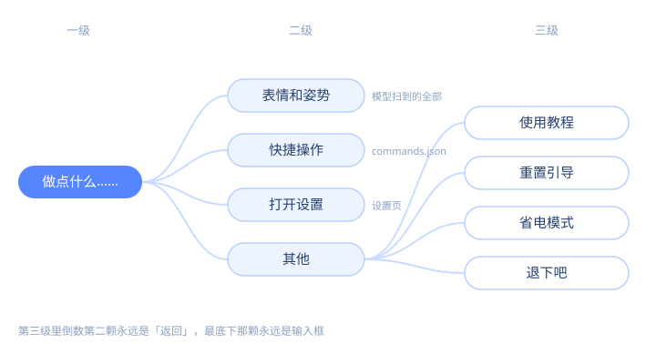
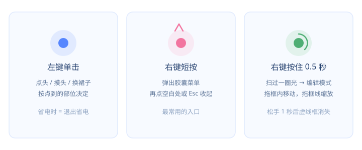
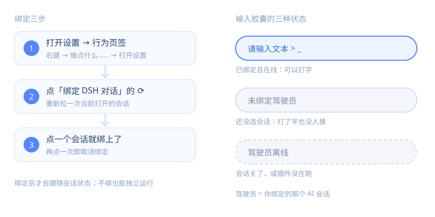
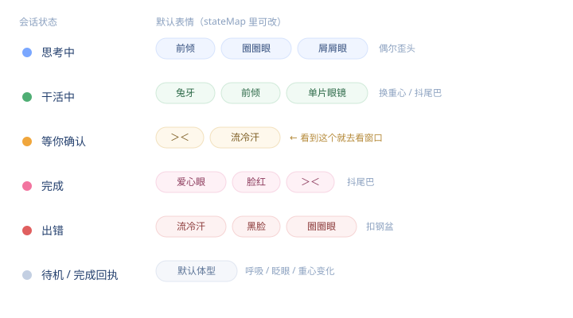

# 桌宠使用教程

> 这份文件是**教程窗口的唯一内容源**：应用里「使用教程」渲染的就是它。改这里，重开窗口即可看到新内容。
> 写给第一次见这个项目的人——不需要懂 Live2D、Electron 或 DSH。

## 0. 这是什么 · 30 秒上手

一只住在屏幕角落的 Live2D 角色：**透明无边框、始终置顶、不吃任务栏**。右键点她就能使唤，左键点她会回应。

三步就能用起来：

1. **启动**：双击仓库根目录的 `launcher.lnk`（没有就先执行 `start.cmd install` 生成一次）。
2. **右键她**：弹出胶囊菜单，点「做点什么……」进第二层。
3. **想让她跟着 AI 会话变表情**：设置 → 行为 → 「绑定 DSH 对话」。这一步是可选的，不绑也是一只完整的桌宠。



## 1. 安装与启动

这节解决「怎么把它跑起来、跑不起来看哪里」。

- **需要什么**：Windows 10/11 + Node.js 22 以上。其余依赖都在 `main/deps/`，不用全局装。
- **首次安装**：

  ```text
  npm --prefix main/deps ci        # 只装依赖；网络慢可先设 ELECTRON_SKIP_BINARY_DOWNLOAD=1 再手动补 electron
  npm --prefix main/deps run build # 构建渲染包 main/modules/ui/build/renderer.bundle.js
  start.cmd install                # 生成根目录 launcher.lnk + 桌面 + 开始菜单快捷方式
  ```

- **日常启动**：双击 `launcher.lnk`（wscript → `main/launcher.vbs` → node → electron）。全程无黑框。
- **要排障时**：双击 `start.cmd`，控制台会一直吐日志。日志同时写 `main/runtime/logs/launch.log`（启动器）与 `run.log`（舞台）。
- **开机自启**：设置 → 行为 → 「开机自启」。
- **退出**：右键菜单 → 其他 → 退下吧；或托盘右键 → 退出；或 `Ctrl+Alt+Q`。
- **卸载**：先退出，删掉整个仓库目录，再删 `~/.dsh/live2d/`（只有握手文件）与 `%LOCALAPPDATA%\BigFatBlueFish\`（插件安装位置）。

## 2. 界面与手势

这节解决「左键右键分别干什么、怎么挪位置」。



- **左键单击角色**：触发互动。点的地方不同反应不同——头/手/腿/尾巴会打招呼，裙摆会换裙子（区域在 `main/config/config.json` 的 `interact.regions` 里，可以自己改）。
- **右键短按**：弹出胶囊菜单。再点一次空白处或按 `Esc` 收起。
- **右键按住约 0.5 秒**：屏幕上会扫过一圈光，松手进入**编辑模式**——出现虚线框，拖框内移动位置，拖框线缩放（0.45×～2.2×）。松手 1 秒后框自动消失。
- **托盘图标**：左键单击 = 开/关省电模式；右键 = 菜单（显示/隐藏、省电模式、打开设置、使用教程、退出）。
- **输入胶囊**：菜单最底下那颗永远是可以打字的输入框，打完回车就把话递给她所在的会话（未绑定时会提示）。

## 3. 右键菜单

这节解决「功能都在哪一层」。

菜单三级封顶，结构固定为：

- **第一级**：只有一颗「做点什么……」（她正在演出时还会多出「停止」之类的临时项）。
- **第二级**：`表情和姿势` / `快捷操作` / `打开设置` / `其他`。
- **第三级**：具体功能。`表情和姿势` 第一项固定是 `恢复默认状态`（表情和姿势点乱了，点它一次回到最干净的样子），后面是模型里扫到的全部表情 + 姿势（分组显示）；`快捷操作` 列出 `main/config/commands.json` 里的指令（最多 20 条）；`其他` 下面是 `使用教程` / `重置引导` / `省电模式` / `退下吧`。

两条规则：

- 进到第三级后，**倒数第二颗胶囊是「返回」**，最底下那颗永远是输入框 —— 想退回去点它，不用找关闭按钮。
- 菜单项里带 `⟳` 的都是会重新读盘的（指令改完不用重启，重新打开菜单就刷新）。

## 4. 绑定 AI 会话

这节解决「怎么让她知道你的 AI 正在干嘛」。



**为什么要绑**：绑上之后，AI 会话的状态（思考中 / 干活中 / 等你确认 / 完成 / 出错）会实时映射成她的表情和姿势，你不用盯着窗口也知道它跑到哪一步了。这需要装 `pet-bridge` 插件（见 `main/docs/install-agent.md`）。

**怎么绑**：

1. 右键 → 做点什么…… → 打开设置 → 行为页签。
2. 点「绑定 DSH 对话」这一行的刷新按钮 `⟳`，列出当前打开的会话。
3. 点一个会话即绑定（再点一次取消）。

**输入胶囊的三种状态**：

- `请输入文本 > _`：已绑定且在线，可以打字。
- `未绑定驾驶员`：还没选会话，打了字也没人接（驾驶员 = 你绑定的那个 AI 会话）。
- `驾驶员离线`：绑定的会话没打开，或插件没在跑。

**没装插件会怎样**：菜单、表情、指令、省电全部照常，只是不跟随会话；想手动换表情就自己点「表情和姿势」。

## 5. 表情与动作

这节解决「她现在这个表情是什么意思」。



默认映射写在 `main/config/config.json` 的 `stateMap` 里，可以直接改：

| 状态 | 表情（会轮换） | 你该做什么 |
| --- | --- | --- |
| `thinking` 思考中 | 前倾 / 圈圈眼 / 屑屑眼，偶尔歪头 | 等 |
| `working` 干活中 | 兔牙 / 前倾 / 单片眼镜，偶尔换重心、抖尾巴 | 等，别打断 |
| `waiting` 等你确认 | ＞＜ / 流冷汗，手按胸口 | **去看窗口**，它在等你点确认 |
| `success` 完成 | 爱心眼 / 脸红 / ＞＜，抖尾巴 | 收结果 |
| `error` 出错 | 流冷汗 / 黑脸 / 圈圈眼，偶尔扣钢盆 | 看报错，或让她重试 |
| `result` / `idle` | 默认体型 | 不用管 |

三点补充：

- 表情池会按 `driftMs` 轮换，所以同一个状态看着也不呆板。
- 手动换的表情不会立刻被状态覆盖，直到下一次状态变化。
- 待机时的呼吸、眨眼、重心变化由 `idle` 段控制；嫌晃可以把 `perf.minimal` 打开，只在状态变化时渲染一帧。

## 6. 快捷指令

这节解决「怎么把常用操作塞进右键菜单」。

- **在哪配**：设置 → 指令页签。左侧列表，右边编辑：名称 / id / 类型 / 命令 / 参数 / 工作目录 / 模式 / 超时。
- **五种类型**：`exe`（直接起程序）、`cmd`（走 cmd.exe）、`powershell`、`bat`（真实 .bat 文件）、`shortcut`（交给系统 shell 打开，适合开文件夹/文档）。
- **参数按行填**：每行一个参数，逐项传给程序，**不拼 shell 字符串**——所以路径里有空格也不用加引号。
- **捕获输出**：打开后会把 stdout/stderr 收回来（等退出码，最长 `timeoutMs`），中文 GBK 会自动转码；关掉就是纯发射后不管。
- **白名单**：菜单里只会出现 `commands.json` 里有的指令，AI 侧也只能跑这些。AI **新增/修改/删除**指令时必须经你确认，确认框会显示完整命令行。
- **示例**：默认带 4 条（打开控制面板 / 打开临时文件夹 / 列出下载文件夹 / 现在几点），五种类型的完整写法见 `main/docs/commands-examples.md`。
- **改完不生效**？重新打开一次菜单即可，不用重启。

## 7. 省电模式

这节解决「开会、打游戏、共享屏幕时怎么让她安静」。

- **进入**：右键菜单 → 其他 → 省电模式；或**左键单击托盘图标**。
- **效果**：半透明、降到 24 帧、只保留呼吸眨眼和待机小动作，不冒气泡、不给驾驶员发消息。
- **退出**：**左键单击角色**、右键短按、再点一次托盘图标都行。省电时右键按住仍然可以拖动位置。
- **自动省电**：设置 → 行为里打开。检测到全屏应用持续 3 秒后自动进入，退出全屏自动恢复；期间你手动退出过，本次全屏就不再自动进。
- **不跨重启保留**：重启后一定回到普通状态。

## 8. 个性化

这节解决「怎么换成自己的角色 / 自己的配色」。

- **换人设（说话的语气和习惯）**：复制 `main/persona/blue-whale-maid/` 成新目录，改里面的 `id` / 名字 / 提示词，再把 `main/config/config.json` 的 `persona` 指向新目录名，重启生效。字段说明与手把手步骤见 `main/persona/README.md`。
- **换模型（换一只角色）**：把 Live2D 模型放进 `main/model/runtime/`，改 `config.json` 的 `model.file`（`model.dir` 保持 `model/runtime`）。仓库**不附带模型**，获取方式见 `main/model/README.md`。
- **换配色**：设置 → 外观 → 三个主题色（背景 / 底纹 / 边框），改完立刻生效。
- **界面尺寸**：设置 → 外观 → 界面尺寸，眯眼或高分屏都能调到合适。
- **帧率**：设置 → 外观 → 30 / 60 / 不限。省电模式不受它影响（固定 24）。
- **改完不生效的项**：涉及 `config.json` 的（模型、姿势、stateMap、窗口尺寸）都要重启舞台；设置页里的开关是即时生效的。

## 9. 排障

这节解决「出问题了先看哪一行」。日志都在 `main/runtime/logs/`。

1. **桌宠没出现在屏幕上**
   先看 `launch.log` 最后几行。写「找不到 node.exe」就装 Node.js 22+；写 EPERM 是被安全软件挡了，把仓库目录加白；什么都没写就手动 `start.cmd` 看控制台。
2. **插件连不上（一直显示驾驶员离线）**
   看 `~/.dsh/live2d/endpoint.json` 是否存在，里面的端口和 `run.log` 里 `[server] 监听` 打的是否一致。再看 `~/.dsh/live2d/bridge-error.log`。端口被占时舞台会顺延到 12405–12414，所以**不要硬编码端口**，一律读 endpoint.json。
3. **动作不生效**
   `run.log` 里搜 `[perform]` / `[face]`：没有这行是没触发（插件/指令那头的问题），有这行但画面没动，基本是被更高优先级的演出顶掉了——等它演完，或右键换一个表情手动压过去。
4. **表情卡住不动**
   右键 → 表情和姿势 → 第一项「恢复默认状态」；插件侧也可以发 `kind=reset`。
5. **改了代码没反应**
   改 `main/modules/**` 下的 `*.js` / `*.mjs` 之后要重新 `npm --prefix main/deps run build`，再重启。
6. **窗口在但一片空白**
   看 `run.log` 的 `[renderer:err]` / `[settings:console]`：多半是改了页面没重新 `npm --prefix main/deps run build`。

## 10. FAQ

- **会不会上传我的数据？** 不会。舞台只监听 `127.0.0.1`，不监听外网、不发任何遥测。会话状态是本地文件（`~/.dsh/live2d/status.json`），插件与桌宠之间也是本地回环。
- **能商用吗？** 代码是 MIT，可以。但 **Live2D 模型不在此列**——模型版权归原作者，商用要单独取得授权；Cubism Core 也受 Live2D 自己的许可约束。
- **支持 macOS / Linux 吗？** 目前只做了 Windows（透明窗口、托盘、快捷方式、全屏检测都是 Windows 实现）。代码没有硬绑，但没适配、没测过。
- **必须装 DSH 吗？** 不必。不装插件就是一只纯桌宠：菜单、表情、指令、省电都能用。
- **能做几只一起养吗？** 不建议：握手文件路径是固定的，多个实例会互相覆盖端口与状态。
- **怎么让她说自定义的话？** 绑定后通过插件的说话能力（气泡），或在人设卡的提示词里写口癖。

---

想改代码？从 `main/docs/README.md` 的文档索引进，`technical.md` 是完整技术事实，`ui-design.md` 是视觉与交互语言。
